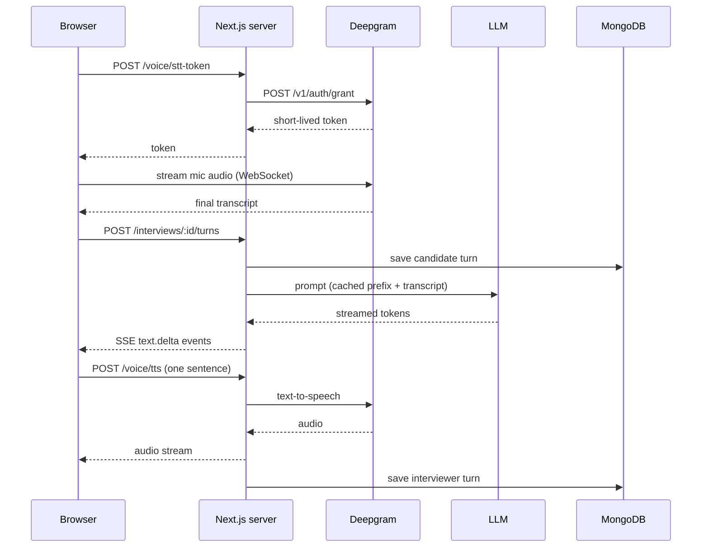

# Interview Me System Design (v0.1)

Draft v0.1 · November 14, 2026 · Companion to PRD v0.2, Database Design v0.2, and API Design v0.1

Status: draft written before the manual interview test (M-1) and the voice spike (M0.5). Section 13 lists the assumptions those milestones must confirm. Expect a v0.2 revision after them.

## 1. Purpose and scope

This document describes how the v1 product is built: components, main flows, the interview state machine, failure handling, security, and deployment. It covers the 5-minute voice interview (with 10-minute option later), feedback report, history, and accounts. It does not cover the employer side, system design rounds, or proctoring.

## 2. Design goals and constraints

- **Solo builder, low cost.** No queues, workers, or microservices in v1. One Next.js app plus managed services.
- **Natural-feeling voice.** The gap between the candidate finishing a sentence and the AI starting to speak should feel conversational. Target to be measured in the voice spike.
- **Privacy by default.** Store transcripts and structured summaries only. No audio and no resume PDFs.
- **Swappable providers.** LLM and voice vendors sit behind thin interfaces so credits running out or price changes do not force a rewrite.
- **Server is the source of truth** for time, quota, and interview state. The browser is never trusted for those.

## 3. Architecture overview

| Layer | Component | Responsibility |
|---|---|---|
| Browser | Onboarding UI | Resume upload, GitHub username, job description, role, level, duration |
| Browser | Interview room | Turn controller, microphone capture and speech-to-text socket, caption panel, audio playback queue, timer display |
| Browser | Code editor (later) | Monaco plus sandboxed JavaScript runner |
| Server | Route handlers (Next.js) | Authentication checks, validation, rate limits, orchestration |
| Server | Profile builder | PDF text extraction, GitHub fetch, LLM structuring |
| Server | Interview engine | Plan generation, prompt assembly, streaming turns, pacing |
| Server | Report generator | Report prompt, schema and quote validation, retries |
| Server | Voice service | Mints short-lived speech-to-text tokens, proxies text-to-speech |
| Server | Model wrapper | One interface over LLM providers, usage logging |
| External | LLM API | Plan, turns, report |
| External | Deepgram | Streaming speech-to-text, text-to-speech |
| External | GitHub API | Public repo metadata and READMEs |
| Data | MongoDB Atlas | Users, profiles, interviews (with embedded turns), reports, usage |

## 4. Key flows

### 4.1 Profile build

1. The client uploads the PDF, GitHub username, and optional job description.
2. The server validates size and type, extracts text from the PDF, and discards the file.
3. The server calls the GitHub API for the user’s top 3–5 public repos (by recent activity), reads each README, and creates a short summary per repo with the LLM. If GitHub is missing, private, or rate limited, it continues with the resume only.
4. The LLM turns the resume text into a structured summary (see Database Design, section on JSON shapes).
5. The profile is saved with status `ready`. The user can review and correct the summary before using it.

This runs as a single request with a loading state. It should finish well within the platform’s function time limit. On failure the profile is marked `failed` and the user can retry.

### 4.2 Interview creation and start

1. `POST /interviews` validates the profile, creates the interview, and generates the plan (strong model). Status becomes `plan_ready`. No quota is used yet.
2. `POST /interviews/:id/start` reserves one interview slot (free or paid) atomically, sets `started_at`, and computes `ends_at`. Status becomes `in_progress`.
3. If the interview fails for a server-side reason before the first candidate answer, the reserved slot is refunded.

### 4.3 Turn loop

Details:

- The server prefixes each candidate message with `[elapsed: m:ss of m:ss]`, computed from the server clock.
- Reply text streams to the client. The client splits it into sentences and requests speech for each finished sentence, so audio starts before the full reply exists.
- The server strips the `[END_OF_INTERVIEW]` marker before anything reaches the client or voice service and reports `is_final: true`.
- Turns are idempotent through `client_turn_id`. A retried request replays the stored reply.

### 4.4 End and report

1. The interview ends when the model finishes, the user ends it, or the time limit plus a short grace period passes. Status becomes `completed`.
2. The server creates a `reports` row with status `pending` and generates the report after sending the response to the client.
3. The report is validated against the schema. Every evidence quote must be an exact substring of the transcript. On failure it retries once with the errors included, then marks the report `failed`.
4. The client polls `GET /interviews/:id/report`. If a completed interview has no report, or a report has been pending too long, that request starts generation again. This heals missed jobs without a scheduler.

## 5. Interview state machine

| State | Meaning | Moves to | Triggered by |
|---|---|---|---|
| `created` | Row exists, plan not ready | `plan_ready`, `failed` | Plan generation |
| `plan_ready` | Plan stored, not started | `in_progress`, `abandoned` | Start call, or cleanup after inactivity |
| `in_progress` | Interview running | `wrapping_up`, `completed`, `abandoned`, `failed` | Server clock, model, or user |
| `wrapping_up` | Last ~30 seconds; AI closes | `completed` | Model marker or time limit |
| `completed` | Interview over; report may be pending | none | |
| `abandoned` | No activity beyond limit | none | Lazy check when read, or daily cleanup |
| `failed` | Unrecoverable server error | none | Error handling |

Report status (`pending`, `ready`, `failed`) is tracked separately on the report.

## 6. Timing and pacing

- `ends_at = started_at + duration_seconds`, computed on the server. The client timer is display only.
- At `ends_at − 30 s`, the next turn carries an instruction to wrap up.
- After `ends_at` plus a short grace period, further answers are rejected with `interview_expired`.
- Silence: if the candidate says nothing for about 12 seconds, the client sends a `silence` turn and the AI offers to rephrase or move on. Exact timing to be tuned in testing.
- A per-interview cost budget is tracked from `usage_events`. If it is exceeded, the interview moves to wrap-up.

## 7. Voice design

- **Speech-to-text:** the server mints a short-lived Deepgram token. Current Deepgram docs say the token is valid for 30 seconds by default and only needs to be valid when the WebSocket opens; the connection then stays open. The browser connects directly, so the API key never reaches the client and no WebSocket runs through the serverless host. The server returns connection parameters (model, language, keyterms from the profile).
- **Turn endings:** use Deepgram’s endpointing to decide when the candidate has finished, plus an on-screen “I’m done” button. Settings are tuned in the voice spike.
- **Half-duplex:** pause speech recognition while the AI is speaking, so the AI doesn’t hear itself through the speakers. No interruption handling in v1.
- **Text-to-speech:** one request per finished sentence through a server proxy, so the proxy can enforce a character budget and log usage. The client plays audio in order from a queue.
- **Captions:** the caption panel shows both speakers live. Candidates can toggle it off.
- **Fallbacks:** browser speech recognition and synthesis, and finally plain text input, if Deepgram fails or credit runs out.

## 8. LLM layer

- Interface with three roles: `plan`, `turn`, `report`. Model names and settings live in config.
- Prompt for turns: versioned system prompt, then a fixed briefing with the selected project, relevant repository context, and key plan topics, followed by the conversation so far. Planning still uses the full profile and report generation uses the complete transcript.
- Structured outputs (plan, report, profile summary) are validated with a schema. One retry with the validation errors, then fail cleanly.
- Timeouts and retries per call. Log input tokens, output tokens, cached tokens, latency, and estimated cost to `usage_events`.
- Prompts treat resume, GitHub, and job description text as data. See Security.

## 9. Failure handling

| Failure | Behavior |
|---|---|
| Speech-to-text socket drops | Reconnect with a new token; if it fails twice, switch to text input and tell the user |
| LLM timeout or error on a turn | Retry once; then show a short message and let the user resend the last answer |
| Text-to-speech fails | Show the text, try browser speech synthesis, continue the interview |
| Deepgram credit exhausted or rate limited | Browser speech fallback; alert the owner through logs |
| Page refresh mid-interview | Reload turns from the database; timer comes from the server; reconnect speech |
| Duplicate request (double click, retry) | Idempotent through `client_turn_id` |
| GitHub error, not found, or rate limited | Continue with resume only and say so |
| Report fails validation | Retry once, then mark `failed`; the user can request regeneration |
| Quota already used | Reject start with `quota_exceeded` |

## 10. Security and privacy

- **Keys:** all provider keys are server-side. The browser only receives short-lived Deepgram tokens. The MongoDB connection string never goes to the client.
- **Prompt injection:** resume, README, and job description text can contain instructions. Wrap them in clearly marked data sections, tell the model to ignore instructions inside them, cap their length, and constrain outputs with schemas. The system prompt never contains secrets.
- **Abuse and cost control:** rate limits per user and per IP, one free interview per account, caps on turns, text length, and characters sent to text-to-speech per interview.
- **Code execution:** candidate JavaScript runs only in a sandboxed iframe or Web Worker in their own browser. Nothing executes on the server.
- **Authorization:** every query is scoped to the signed-in user through shared helper functions. MongoDB has no row-level security, so route tests must confirm that one user cannot reach another’s data.
- **Privacy:** consent screen names every processor and what is stored. Store transcripts, not audio or PDFs. Apply each provider’s data-use and retention settings, including opting out of training use where offered. Support deletion of all user data. No real user data on free tiers that allow product-improvement use.

## 11. Observability

- Structured logs with `request_id`, `user_id`, and `interview_id` on every request. Do not log resume text or transcripts.
- Error tracking on client and server.
- Metrics to track: end-of-speech to first-audio latency (reported by the client), per-turn LLM latency, cost per interview, completion rate, report failure rate, speech-to-text fallback rate.
- A saved query or small admin script for cost and usage per interview, using the usage totals stored on each interview.

## 12. Deployment and environments

- **App:** Next.js route handlers on a serverless host such as Vercel, using the Node.js runtime. Set `maxDuration` per route (turns short, profile and report longer). Current Vercel docs list a 300-second default and Hobby maximum under Fluid compute. Check the host’s terms before launch: Vercel’s Hobby plan is meant for non-commercial use, so plan on a paid plan or another host once you charge users.
- **Database:** MongoDB Atlas. The free cluster has 512 MB of storage, up to 500 connections, and a cap of about 100 operations per second, and Atlas pauses it after a period of inactivity. That is fine for development. Reuse one database client per server instance so serverless functions do not exhaust connections, and use a paid cluster before real users arrive. Atlas blocks unknown IPs by default, and serverless hosts use changing addresses, so review the network access setup before launch.
- **Environments:** local, staging, production, each with its own keys and database. Secrets in the host’s environment settings.
- **Region:** place the app and database in the same region, close to most users.
- **Indexes:** an index setup script in version control (see Database Design).

## 13. Assumptions to validate

| Assumption | Validated by |
|---|---|
| Interview questions and feedback are good enough to be useful | M-1 manual test |
| The plan step improves quality enough to justify its cost | M-1 and M0 |
| Deepgram handles Indian-accented English, technical terms, and some Hinglish well enough | M0.5 voice spike |
| Sentence-by-sentence text-to-speech keeps latency acceptable | M0.5 |
| Endpointing settings give natural turn-taking | M0.5 |
| Cost per interview stays within the PRD estimate | M0 and M0.5 |
| A 5-minute interview gives enough evidence for scores | M-1 |
| Platform limits (duration, free-tier pausing, terms) still hold at build time | Before M1 |
| Atlas free cluster handles prototype load and serverless connections | M0 and M1 |

## 14. Out of scope for v1

Employer dashboard and matching, system design and behavioral rounds, video and proctoring, WebRTC or speech-to-speech realtime, interruption handling, queues and background workers, and languages other than JavaScript for coding.
